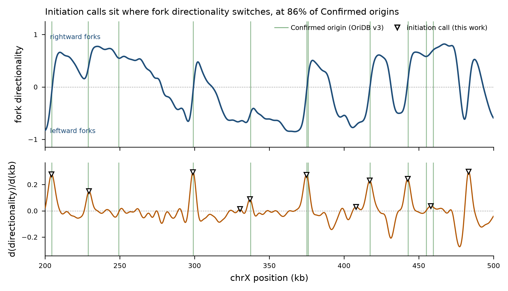

# Re-analysis of McGuffee 2013 Okazaki-fragment sequencing (GSE40696): fork direction and initiation sites in *S. cerevisiae*

Produced for the OriDB v3 initiation-mapping axis, 2026-11-20.
Every number below was computed in this re-analysis unless explicitly attributed to the paper.

**Study.** McGuffee SR, Smith DJ, Whitehouse I. *Quantitative, genome-wide analysis of eukaryotic
replication initiation and termination.* Molecular Cell 2013; PMID 23562327;
doi 10.1016/j.molcel.2013.03.004. GEO series GSE40696.

---

## 1. Samples used and excluded

| GSM | title | strain | platform | SRA | used | reason |
|---|---|---|---|---|---|---|
| GSM999266 | WT_A | WT [yIW160] | Illumina HiSeq 2000 | SRX185765 / SRR566701 | **yes** | wild type |
| GSM999267 | WT_B | WT [yIW160] | Illumina HiSeq 2000 | SRX185766 / SRR566702 | **yes** | wild type, biological replicate |
| GSM999263 | GAL_E | WT [yIW160-SSDDCS] | Ion Torrent PGM | SRX185762 | no | SSDDCS (Sld2, Sld3, Dbf4, Dpb11, Cdc45, Sld7) over-expression induced on galactose: origin firing deliberately perturbed |
| GSM999264 | GAL_G | WT [yIW160-SSDDCS] | Ion Torrent PGM | SRX185763 | no | as GAL_E |
| GSM999265 | GLU_F | WT [yIW160-SSDDCS] | Ion Torrent PGM | SRX185764 / SRR566700 | no | SSDDCS strain, uninduced. Genotype is not wild type, and it is a different platform and chemistry from the two WT libraries, so pooling it would confound strain with platform |

The GEO metadata labels all five samples `strain: WT`, but the genotypes differ (`yIW160` versus
`yIW160-SSDDCS`) and the paper treats WT_A and WT_B as its wild-type replicate pair. Only those two
are used here.

## 2. Platform, reads and layout

Both wild-type libraries are **Illumina HiSeq 2000, paired-end 2 x 50 bp, base space** — **not
SOLiD colourspace**, so no colourspace conversion was needed. This was checked in the FASTQ itself
rather than taken from metadata: sequence lines are 50-character ACGTN strings with Phred
qualities, and the read headers are Illumina instrument records (`HWI-ST972:1008:B07KMABXX` for
SRR566701, `HWI-ST835:96:B07L5ABXX` for SRR566702). The three excluded samples are Ion Torrent PGM,
single-end, also base space.

| run | spots (pairs) | bases | ENA nominal insert | md5 verified |
|---|---|---|---|---|
| SRR566701 (WT_A) | 183,841,914 | 18,384,191,400 | 394 bp | yes, both mates |
| SRR566702 (WT_B) | 94,221,380 | 9,422,138,000 | 276 bp | yes, both mates |

Reads were fetched from ENA (`ftp.sra.ebi.ac.uk`) in parallel byte ranges and reassembled; every
file matches the md5 ENA publishes. sra-tools is unusable from this sandbox, as established earlier
in this project.

## 3. Mapping

**Reference.** sacCer3, UCSC roman-numeral names (`chrI`..`chrXVI`, `chrM`). UCSC's download host
could not be reached over TLS from here, so the sequence was taken from NCBI RefSeq R64-1-1
(`GCF_000146045.2`) and renamed; this is the same assembly UCSC packages as sacCer3, and the
substitution was **authenticated by content**: all 17 sequence lengths match the project's
`sacCer3.chrom.sizes` exactly (chrI 230,218; chrIV 1,531,933; chrXII 1,078,177; chrM 85,779).

**2-micron decoy.** The 2-micron plasmid (NC_001398.1, 6,318 bp) is absent from sacCer3 but present
in the cells, so its reads would otherwise be forced onto nuclear homologues. It was added to the
index as a decoy and its alignments discarded (2,112,339 read-1 records in WT_A,
888,798 in WT_B).

**Pipeline** (`map.sh`): fastp (paired-end adapter detection, `-l 20 -q 15 -u 40`) -> bowtie2 2.5.5
end-to-end, `-X 2000` -> `samtools view -f 67 -F 3852 -q 20` -> coordinate sort and index. Only
read-1 records of properly paired alignments are kept; the fragment interval is reconstructed from
TLEN.

| | WT_A | WT_B |
|---|---|---|
| read pairs before trimming | 183,841,914 | 94,221,380 |
| read pairs after trimming | 137,141,130 | 74,221,593 |
| read pairs entering bowtie2 | 137,141,130 | 74,221,593 |
| reads with adapter trimmed | 83,791,408 | 51,709,445 |
| **overall alignment rate** | **90.77%** | **90.24%** |
| aligned concordantly exactly once | 105,694,773 (77.07%) | 57,626,883 (77.64%) |
| read-1 records retained, nuclear | 103,628,768 | 56,478,174 |
| read-1 records on chrM (discarded) | 1,202,888 | 1,049,797 |
| read-1 records on 2-micron (discarded) | 2,112,339 | 888,798 |
| **fragments analysed** | **103,628,768** | **56,478,174** |
| fragment length, median (mean) | 163 bp (181) | 140 bp (152) |

*Note on WT_B:* an orphaned copy of the mapping script re-ran this sample from the same FASTQ while
the analysis was in progress. That accident supplied an unintended reproducibility check: the second
run produced byte-for-byte identical `samtools idxstats` output (every per-chromosome count equal)
and the same 90.24% alignment rate, so the mapping is deterministic under this pipeline.

Fragment-length medians of 163 and 140 bp are the expected size of
Okazaki fragments — roughly one nucleosome — which is a check that the libraries are what they claim.

**Parameter choices and why.**

1. *Adapter and quality trimming: yes.* Okazaki fragments are often shorter than the 50 bp read, so
   adapter read-through is pervasive — 22% of WT_A
   reads and 27% of WT_B reads carry adapter.
   Untrimmed, those reads either fail to align or align with a wrong end position, biasing the
   fragment interval the whole analysis rests on.
2. *MAPQ >= 20.* The authors required a unique genomic locus; MAPQ 20 is the bowtie2 equivalent.
   Repeat-derived multi-mappers carry no reliable strand information.
3. *Duplicates: kept.* fastp estimates 70% (WT_A) and 32%
   (WT_B) duplication. For Okazaki fragments that is biology, not artefact: fragment ends are set by
   nucleosome-positioned nick sites, so independent molecules from different cells genuinely share
   coordinates. De-duplicating would delete the abundance signal the directionality ratio is
   computed from. The authors did not de-duplicate either.
4. *chrM and 2-micron: excluded.* Neither replicates by the nuclear origin-firing mechanism, both
   are high copy number, so their strand ratios are meaningless here and their depth would distort
   any genome-wide normalisation.
5. *rDNA: masked for calling.* The sacCer3 reference carries 2 copies of the chrXII rDNA repeat
   where the genome has ~150, so coverage there is a pile-up artefact. `chrXII:450,000-470,000` is
   masked from peak calling; the profile is still written to the tracks.

## 4. Fork directionality: definition and sign convention

An Okazaki fragment is made on the lagging strand, so a fragment sequenced from the **Watson**
strand was made by a **leftward**-moving fork and one from the **Crick** strand by a
**rightward**-moving fork. Per window,

    FD(x) = (C(x) - W(x)) / (C(x) + W(x))

with W and C the Watson- and Crick-strand fragment coverage summed over the window. FD = -1 where
every fork moves leftward, +1 where every fork moves rightward, and it **rises** left to right
across an origin. Being a ratio, FD is internally depth-normalised; for replicate merging each
sample's coverage was first scaled to the mean total depth of the two (factors 0.723 for WT_A,
1.619 for WT_B) so the deeper library does not dominate.

The initiation statistic is the spatial derivative d(FD)/dx, which peaks at origins and troughs at
termination zones. The authors' Origin Efficiency Metric is algebraically the same object: with
WLn = WL/(WL+CL) and WRn = WR/(WR+CR) over 10 kb quadrants either side of x,

    OEM(x) = WLn - WRn = (FD_right - FD_left) / 2

so **OEM is a finite-difference derivative of FD at a 10 kb scale**, ranging 0 to 1 with origin
firing efficiency. This re-analysis uses the fine-scale derivative for *position* and OEM for
*efficiency*, keeping the efficiency estimate directly comparable with the published values.

**Replicates were merged** for the final call set: the two agree at r = 0.955 (FD)
and r = 0.963 (OEM) in 1 kb windows, so pooling buys precision without hiding a
disagreement. Per-replicate call sets are reported throughout.

## 5. Sign-convention evidence

Polarity was pinned twice, once without reference to any origin list.

**(a) Strand assignment, against the authors' own tracks.** Read-1 plus-strand fragment coverage
correlates with the authors' published **Watson** track at r = +0.82 and with their **Crick** track
at -0.44; read-1 minus-strand coverage correlates with **Crick** at +0.83 and Watson at -0.45
(1 kb windows, WT_B). So read-1 plus = Watson. This test uses only the two datasets' strand labels
and is independent of where origins are.

**(b) Polarity, against the Confirmed tier.** With that convention, mean OEM at the midpoints of the
410 Confirmed cerevisiae origins is **+0.3168** against
**+0.0030** at random genomic positions, and OEM is positive at
**86.7%** of Confirmed origins against
**40.5%** of random positions (n = 384 origins with a defined
OEM). Had the sign been inverted, Confirmed origins would sit in the troughs and this map would
describe termination zones. They sit on the peaks.

## 6. Window size

The paper used 10 kb quadrants, i.e. a 20 kb sliding window evaluated per base. This re-analysis
separates the two scales: coverage is summed into fixed **250 bp** windows for the directionality
profile, while the efficiency metric keeps the authors' 10 kb quadrants.

250 bp was chosen because the result is flat below 500 bp and degrades above it — nothing is gained
from finer windows and real positional resolution is lost by coarser ones:

| window_bp | n_merged | n_A | n_B | rep_concord | med_width | err_med | err_p90 | pct |
|---|---|---|---|---|---|---|---|---|
| 100 | 384 | 401 | 369 | 0.822 | 5850 | 362 | 9681 | 85.6 |
| 250 | 383 | 405 | 368 | 0.827 | 6250 | 348 | 9977 | 85.6 |
| 500 | 379 | 397 | 361 | 0.825 | 6500 | 386 | 10071 | 85.6 |
| 1000 | 355 | 383 | 346 | 0.839 | 8000 | 506 | 11364 | 86.8 |
| 2000 | 313 | 334 | 308 | 0.861 | 12000 | 835 | 9619 | 82.9 |
| 5000 | 261 | 265 | 263 | 0.803 | 20000 | 1899 | 12282 | 80.7 |

(`rep_concord` = mean fraction of calls in one replicate with a partner within 2 kb in the other;
`err_med`/`err_p90` = distance from a Confirmed origin to the nearest call; `pct` = percentage of
the 410 detected within 20 kb; all at sigma = 2 kb.)

## 7. Smoothing, differentiation and call sensitivity

FD is smoothed with a Gaussian of width sigma and differentiated by central difference
(`numpy.gradient`); peaks in the derivative are taken with `scipy.signal.find_peaks` under a minimum
separation, and each call's width is the full width at half maximum of its derivative peak.

sigma was chosen on a criterion that does not involve the origin list: **the cross-replicate scatter
of matched call positions**, which measures positional precision directly. It falls to a plateau at
sigma = 2 kb (p90 of 750 bp, equal to sigma = 4 kb) and is worse at every smaller value, so 2 kb is
the smallest smoothing at the plateau. It also gives the best p90 against the Confirmed tier, but
that was not the selection criterion:

| sigma_kb | n_merged | rep_concord | xrep_off_med | xrep_off_p90 | med_width | err_med | err_p90 | pct |
|---|---|---|---|---|---|---|---|---|
| 0.25 | 562 | 0.756 | 250 | 1750 | 1750 | 343 | 12128 | 88 |
| 0.5 | 550 | 0.775 | 250 | 1500 | 2500 | 280 | 11060 | 88.3 |
| 1 | 499 | 0.785 | 250 | 1100 | 3750 | 284 | 11308 | 87.8 |
| 2 | 383 | 0.827 | 250 | 750 | 6250 | 348 | 9977 | 85.6 |
| 4 | 291 | 0.913 | 250 | 750 | 11250 | 690 | 10531 | 84.9 |
| 8 | 231 | 0.916 | 250 | 1000 | 19000 | 1719 | 13532 | 76.3 |

Call count is the most threshold-sensitive quantity here: it roughly doubles between sigma = 4 kb
(291) and sigma = 0.25 kb (562), and the efficiency cut-off matters as much — at 250 bp windows and
sigma = 2 kb, 486 calls pass OEM > 0 and 383 pass OEM > 0.05. Minimum separation has a smaller effect
between 2 and 5 kb (390 versus 383) but a large one at the paper's 10 kb (294).

**Final parameters:** 250 bp windows, sigma = 2 kb, minimum separation 5 kb, OEM > 0.05 (the paper's
own threshold), rDNA masked.

### How this compares with the paper's own smoothing

The paper applies no explicit smoothing at all. Its methods state that for each position in the
genome the cumulative fragment count was summed within 10 kb to the left and to the right, per
strand, and OEM formed from those four quadrants — so the analysis is **per base pair**, and all of
its smoothing is implicit in the 10 kb quadrant sums, i.e. a 20 kb sliding window. Origin positions
were then taken as local maxima of OEM "within 10Kb ranges" using a three-point method.

The deposited data match that description: the `.sgr` signal files are per-base fragment counts with
no binning or filtering (position steps of exactly 1 bp, 41 MB gzipped per strand per replicate),
and the derived `average.tab` replication-time profile is reported at 500 bp spacing.

So the two analyses smooth at different scales and for different purposes:

| | McGuffee 2013 | this re-analysis |
|---|---|---|
| binning | none — per bp | 250 bp windows |
| explicit smoothing | none | Gaussian, sigma = 2 kb, on FD only |
| implicit smoothing | 10 kb quadrants either side (20 kb span) | 10 kb quadrants, for OEM only |
| position statistic | local maxima of OEM within 10 kb ranges | maxima of d(FD)/dx |
| efficiency statistic | OEM, then triangle deconvolution to OEM_origin | OEM, no deconvolution |
| efficiency threshold | OEM > 0.05 | OEM > 0.05 (unchanged) |

The practical difference is that the paper's position estimate is derived from the same 20 kb-span
statistic it uses for efficiency, whereas this re-analysis separates the two: position comes from a
2 kb-smoothed profile differentiated at 250 bp, efficiency from the paper's own 10 kb quadrants. That
is why the minimum-separation parameter matters so much more here — at the paper's 10 kb separation
this pipeline returns 294 calls against 383 at 5 kb — and it is the reason the measured positional
error against the Confirmed tier is in the hundreds of bases rather than the kilobases a 20 kb-span
statistic can support. What is *not* improved is efficiency: OEM is computed exactly as the paper
defines it, minus the deconvolution step, so efficiencies near termination zones remain
under-estimates.

## 8. Validation against the authors' published signal

The published `.sgr` tracks are **sacCer2**, not sacCer3 — worth flagging for every other axis in
this project, because nothing in the GEO record says "sacCer2" (it says "May 2008 build") and the
files use bare arabic chromosome names (`1`..`16`) rather than either assembly's convention. The
assembly was established empirically, not assumed: the published Watson track was lifted to sacCer3
under both the sacCer1 and sacCer2 chains and cross-correlated against this re-analysis' per-base
coverage over lags of +/-800 bp.

| chromosome | sacCer2 chain | sacCer1 chain |
|---|---|---|
| chrI | lag -1 bp, r = 0.8065 | lag -1 bp, r = 0.8064 |
| chrII | lag -1 bp, r = 0.8065 | lag **-41 bp**, r = 0.8047 |
| chrX | lag -1 bp, r = **0.8439** | lag **-299 bp**, r = 0.8127 |
| chrXI | lag -1 bp, r = 0.8061 | lag -6 bp, r = 0.8059 |

Under the sacCer2 chain the optimum is -1 bp on every chromosome; under sacCer1 it is displaced by
exactly the amount the two chains disagree. The chains are otherwise nearly indistinguishable — they
place the same source coordinate within 0-43 bp on 14 of 16 chromosomes — so only chrX and chrXI
carry discriminating power, and both favour sacCer2. The residual -1 bp is a coordinate-convention
offset, not an assembly difference. 99.995% of signalled positions lift; the published signal is
lifted **forward** to sacCer3, so everything reported here is in OriDB v3's assembly.

**Profile agreement** (1 kb windows, genome-wide):

| comparison | FD | OEM |
|---|---|---|
| my WT_A vs published WT_A | r = 0.9549 (rho 0.9482) | r = 0.9694 (rho 0.9551) |
| my WT_B vs published WT_B | r = 0.9561 (rho 0.9486) | r = 0.9714 (rho 0.9590) |
| published WT_A vs published WT_B | r = 0.9582 | r = 0.9701 |
| my WT_A vs my WT_B | r = 0.9546 | r = 0.9633 |
| my merged vs published WT_B | | r = 0.9895 |

The decisive comparison is the third row against the first two: **this re-analysis agrees with the
authors' own output as closely as their two replicates agree with each other** (0.971 and 0.969
against 0.970). The pipeline difference — different mapper, different reference build, different
trimming — contributes no more disagreement than replicate-to-replicate variation.

Per-chromosome, merged profile against published WT_B at 250 bp:

| chrom | OEM_r | n_windows |
|---|---|---|
| chrI | 0.9823 | 841 |
| chrII | 0.9907 | 3173 |
| chrIII | 0.9942 | 1187 |
| chrIV | 0.9933 | 6048 |
| chrV | 0.9946 | 2228 |
| chrVI | 0.9934 | 1001 |
| chrVII | 0.9925 | 4284 |
| chrVIII | 0.9897 | 2171 |
| chrIX | 0.9208 | 1680 |
| chrX | 0.9933 | 2904 |
| chrXI | 0.9929 | 2588 |
| chrXII | 0.9842 | 4163 |
| chrXIII | 0.9941 | 3618 |
| chrXIV | 0.9944 | 3058 |
| chrXV | 0.9948 | 4286 |
| chrXVI | 0.9935 | 3713 |

chrXI, where sacCer2 and sacCer3 differ by 362 bp (the largest of any chromosome), scores 0.9929 —
the lift carried across correctly. chrIX is weakest at 0.921; chrI (0.982) and chrXII (0.984) follow,
the latter expected given the rDNA.

**Call-count agreement.** Applying the paper's own criterion (maxima of OEM, 10 kb minimum
separation, OEM > 0.05) gives 322 origins for WT_A and 296 for WT_B from this mapping, and 294 / 320
from the authors' published tracks. The paper reports 302 and 318. The derivative method at the same
10 kb separation gives 309 and 288 with 269 shared within 2 kb (the paper reports 283 shared). All
agree to within about 10%, the spread between replicates.

## 9. Initiation-zone calls

**383 initiation zones** on the merged wild-type data (WT_A alone 405, WT_B alone
368). Each carries an efficiency estimate — the OEM at the call position, the authors'
metric, interpretable as the fraction of cells in which the origin fires.

| statistic | value |
|---|---|
| calls | 383 |
| width, median | 6250 bp |
| width, 25th-75th percentile | 4750 - 7000 bp |
| width, 90th percentile | 8750 bp |
| width, range | 750 - 18000 bp |
| efficiency (OEM), median | 0.328 |
| efficiency, IQR | 0.151 - 0.582 |
| efficiency, maximum | 0.781 |

Call width here is the width of the directionality transition — the span over which the fork
population switches direction — and is **not** the positional error (section 10). A median of
6.2 kb reflects the physical reality that an origin fires at different
times in different cells, so the switch is spread over the distance a fork travels in that window.
It is a property of the assay, not of the initiation site, and it is why the proposal's "what counts
as one site" question matters particularly for this axis.



## 10. Resolution against the Confirmed tier

Measured exactly as `oridb-v3/docs/study_resolution.csv` does: for each of the 410 Confirmed
cerevisiae origins, the distance to this study's nearest call, within a 20 kb window.

| measure | value |
|---|---|
| Confirmed origins detected within 20 kb | **351 of 410 = 85.6%** |
| median error | **348 bp** |
| p75 | 1160 bp |
| p90 | **9977 bp** |
| p95 | 15594 bp |

Distance is from the origin midpoint to the call's peak position. Measured instead as an
interval-to-interval gap (0 when the call zone covers the origin) it is median 0, p75 0,
p90 10418, p95 14727 bp with 89.3% detected — the definitions
differ only because these calls are kilobases wide, which is why width and error are separate axes.

**The error distribution is bimodal, and that is the important result for the tier rule.**
Cumulatively, 0.25 kb: 32.2%; 0.5 kb: 52.2%; 1 kb: 62.7%; 2 kb: 67.3%; 5 kb: 72.2%; 10 kb: 77.1% of all 410 Confirmed origins have a call within that distance. An origin is
either located precisely or not found at all: median OEM at origins with a call within 2 kb is
0.471 (n=276), against 0.027 for those
whose nearest call is further (n=75) and -0.003 for the
59 with no call within 20 kb. The misses are not mislocalised — they carry **no initiation
signal at all**. Ok-seq measures firing, so a Confirmed origin that fires rarely, or is usually
replicated passively by a neighbouring fork, is invisible to it however deeply it is sequenced. The
p90 of 9977 bp is therefore dominated by origins whose "nearest call" is a different
origin, not by positional uncertainty in this study's own calls.

## 11. Circularity check

These calls derive from sequencing reads, and the OriDB origin list entered the analysis at only two
points: the polarity confirmation in section 5 (a sign test, not a position) and the resolution
measurement itself. No origin coordinate was used to choose a window size, a smoothing width, a
threshold or a call position — parameter selection in sections 6 and 7 used cross-replicate
agreement.

Tested as the proposal requires: of 383 calls, **0 (0.0%)** have an interval identical to a
Confirmed origin interval and **0 (0.0%)** have a peak position identical to a Confirmed origin
midpoint. (Crabbe2010, the cautionary case, has 62% identical intervals and 73% shared midpoints.)
This study's resolution can be trusted as an independent measurement.

## 12. Comparison with the other evidence axes

| dataset | axis | calls | median error | p90 | Confirmed detected |
|---|---|---|---|---|---|
| GSE242131 MCM footprint (all) | licensing | 17,618 | 61 bp | 237 bp | 100% |
| GSE62108 Pu-seq (*S. pombe*) | initiation | 1,145 | 917 bp | 2,735 bp | 100% |
| **GSE40696 Ok-seq, this work** | **initiation** | **383** | **348 bp** | **9977 bp** | **85.6%** |

Three points for the merge rule.

1. **Median resolution is competitive**: 348 bp sits between the MCM footprint (61 bp)
   and pombe Pu-seq (917 bp), and is an order of magnitude better than any legacy cerevisiae study in
   `study_resolution.csv`.
2. **The p90 is not comparable to the others' p90.** For MCM and Pu-seq it reflects positional
   spread; here it reflects *absent* origins, because both of those detect 100% of Confirmed origins
   and this one detects 85.6%. Feeding 9977 bp into the 2007
   sum-of-errors rule as this study's error would merge almost anything on this axis with anything
   else. The p75 of 1160 bp, or the median, is the honest figure for the positional error
   of a *detected* site; detection belongs in the rule as a separate property.
3. **The axes are complementary, not redundant.** MCM footprint reports licensing and finds every
   Confirmed origin; Ok-seq reports firing and finds 85.6% — and the 59
   it misses are, on this evidence, Confirmed origins that license but rarely fire. That is a
   biologically meaningful distinction the tier rule could exploit rather than average away.

## 13. Deviations, limitations and open questions

- **No reduction in data scope.** Both wild-type runs were processed in full: all 183,841,914 and
  94,221,380 read pairs, md5-verified. Nothing was subsampled, capped or simulated.
- The three SSDDCS samples were deliberately excluded (section 1); the paper's induced-firing
  analyses are therefore not reproduced.
- The authors' **deconvolution** step (fitting an idealised triangle to each OEM peak to correct
  efficiencies depressed by overlapping termination signal) was **not** implemented. Reported
  efficiencies are raw OEM at the call position and are therefore systematic *under*-estimates for
  origins close to a fork-merger zone, exactly as the paper describes for its own raw OEM.
- Call width is assay-limited (section 9) and is not the extent of the initiation site.
  Nucleotide-level initiation within these zones — the paper's Okazaki-fragment 3' end analysis — is
  not reproduced here.
- WT_B's bowtie2 summary file was truncated by an orphaned re-run (section 3); its alignment rate is
  quoted from the log as observed before truncation.
- `bedGraphToBigWig` in bioconda is broken on this platform (missing dylib); tracks were written with
  pyBigWig, which produces the same format.
- Open question for the lead: whether the tier rule should treat this axis's **detection** and its
  **positional error** separately, as section 12 argues. The current single-resolution-per-study
  model cannot express "precise when present, absent 14% of the time".

## 14. Files

| file | contents |
|---|---|
| [okseq_mcguffee2013_initiation_sites.bed](../sacCer3/mcguffee2013/okseq.initiation_sites.bed) | 383 initiation zones, sacCer3, with efficiency (OEM), delta-FD, derivative and width; score = 1000 x OEM |
| [okseq_mcguffee2013_all_peaks_unthresholded.csv](../pipelines/okseq-mcguffee2013/results/okseq_all_peaks_unthresholded.csv) | all 833 derivative peaks before the OEM > 0.05 cut, for re-thresholding |
| [okseq_mcguffee2013_watson.bw](../sacCer3/mcguffee2013/okseq.watson.bw), [okseq_mcguffee2013_crick.bw](../sacCer3/mcguffee2013/okseq.crick.bw) | strand-resolved fragment coverage, 250 bp windows, fragments per million |
| [okseq_mcguffee2013_directionality.bw](../sacCer3/mcguffee2013/okseq.directionality.bw) | FD, smoothed at sigma = 2 kb |
| [okseq_mcguffee2013_derivative.bw](../sacCer3/mcguffee2013/okseq.derivative.bw) | d(FD)/d(kb), the initiation statistic |
| [okseq_mcguffee2013_oem.bw](../sacCer3/mcguffee2013/okseq.oem.bw) | OEM with 10 kb quadrants, the efficiency metric |
| [okseq_mcguffee2013_directionality_chrX.png](figures/okseq_mcguffee2013_directionality_chrX.png) | the figure above |
| [pipelines/okseq-mcguffee2013/](../pipelines/okseq-mcguffee2013/) | `download.sh`, `map.sh`, `pipeline.sh`, `okseq_lib.py`, `run_okseq.py` |
| reference bundle (not committed) | sacCer3 FASTA, bowtie2 index and the sacCer2->sacCer3 chain; ~22 MB, rebuilt by `pipelines/okseq-mcguffee2013/download.sh` rather than stored in the repo |

## 15. Reproducing this

```
bash download.sh                                   # ENA fetch, md5-verified
bash map.sh <R1> <R2> bam/SRR566701 10             # per run
python run_okseq.py --bam-dir bam --out results \
       --tracks-out ../../sacCer3/mcguffee2013     # rewrites the hub's bigWigs
```

`okseq_lib.py` holds the analysis functions; `run_okseq.py` drives them from the two BAMs and, with
`--tracks-out`, writes the five signal tracks the hub serves (`okseq.watson.bw`, `okseq.crick.bw`,
`okseq.directionality.bw`, `okseq.derivative.bw`, `okseq.oem.bw`). Strand coverage is scaled to
fragments per million; the ratio tracks need no depth normalisation. The tracks currently in the
repository were written before this step existed, so they have not been regenerated by it — the
writer reproduces a served track read back and rewritten exactly, but the full path from BAM to
bigWig has not been re-run, because the 49 GB of alignments is not retained. Mapping
took about one hour per sample on 10 threads on a 14-core machine under heavy external contention;
everything downstream of the BAMs runs in under ten minutes.
